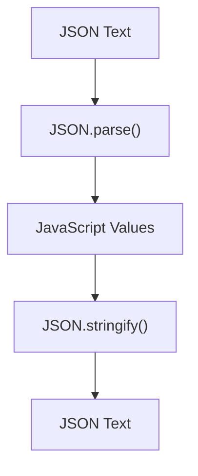

# JavaScript Window BOM (Browser Object Model)

All global JavaScript objects, functions, and variables **automatically** become members of the `window` object.

```JavaScript
window.document.getElementById("header");
```
is the same as 
```js
document.getElementById("header");
```

## Window Size

Two properties can be used to determine the size of a window.

Both return the sizes in pixels:
- `window.innerHeight` 
- `window.innerWidth`

*Other window methods*
- `window.open()` - open a new window
- `window.close()` - close the current window
- `window.moveTo()` - move the current window
- `window.resizeTo()` - resize the current window

## Window Screen

The `window.screen` object can be written without the window prefix.
- `screen.widht` - returns the width of the visitor's screen
- `screen.height` - returns the height of the visitor's screen
- `screen.availWidth`
- `screen.availHeight`

## Window location

The `window.location` object can be used to get the current page address (URL) and to redirect the browser to a new page.

The `window.location` can be written without the window prefix.
- `window.location.href` returns the href (URL) of the current page
- `window.location.hostname` returns the domain name of the web host
- `window.location.pathname` returns the path and filename of the current page
- `window.location.protocol` returns the web protocol used (http: or https:)
- `window.location.assign()` loads a new document

## JavaScript History API

The History API is accessed with the `window.history` object.

The `history` object can be written without the window prefix.

The most common methods are:
- `history.back()` - same as clicking back in the browser
- `history.forward()` - same as clicking forward in the browser

## JavaScript Window Navigator

The `navigator` object contains information about the visitor's browser.

- `navigator.cookieEnabled` - returns true if cookies are enabled.
- `navigator.language` - browser's language.
- `navigator.onLine` - true if the browser is online

## JavaScript Popup Boxes

JavaScript has 3 kinds of popup boxes:
1. Alert box `alert("sometext");`
2. Confirm box `confirm("sometext");`
3. Prompt box `prompt("sometext", "defaultText");`

## JavaScript Cookies

Cookies are data, stored in small text files, on your computer.

Cookies solve the problem "how to remember information about the user."

```js
// cookie can be created 
document.cookie = "username=John Doe";

// expiry date || By default cookies are deleted when the browser is closed
document.cookie = "username=John Doe; expires=Thu, 18 Dec 2013 12:00:00 UTC";

// With a path parameter, you can tell the browser what path the cookie belongs to. By default, the cookie belongs to the current page.
document.cookie = "username=John Doe; expires=Thu, 18 Dec 2013 12:00:00 UTC; path=/";

// read a cookie
let x = document.cookie;

// change a cookie the same way that it is created.
document.cookie = "username=John Smith; expires=Thu, 18 Dec 2013 12:00:00 UTC; path=/";

// delete a cookie by setting the expiry parameter to the past
document.cookie = "username=; expires=Thu, 01 Jan 1970 00:00:00 UTC; path=/;";
```

### Set cookie function
```js
function setCookie(cname, cvalue, exdays) {  
  const d = new Date();  
  d.setTime(d.getTime() + (exdays*24*60*60*1000));  
  let expires = "expires="+ d.toUTCString();  
  document.cookie = cname + "=" + cvalue + ";" + expires + ";path=/";  
}
```

### Get cookie
```js
function getCookie(cname) {  
  let name = cname + "=";  
  let decodedCookie = decodeURIComponent(document.cookie);  
  let ca = decodedCookie.split(';');  
  for(let i = 0; i <ca.length; i++) {  
    let c = ca[i];  
    while (c.charAt(0) == ' ') {  
      c = c.substring(1);  
    }  
    if (c.indexOf(name) == 0) {  
      return c.substring(name.length, c.length);  
    }  
  }  
  return "";  
}
```

### Check a cookie

We create a function that checks if a cookie is set.
```js
function checkCookie() {  
  let username = getCookie("username");  
  if (username != "") {  
   alert("Welcome again " + username);  
  } else {  
    username = prompt("Please enter your name:", "");  
    if (username != "" && username != null) {  
      setCookie("username", username, 365);  
    }  
  }  
}
```

---

# JavaScript Fetch API

JavaScript Fetch API is used to make asynchronous network requests to web servers.

Fetch uses standard JavaScript **Promises**.

## Fething a Text File

```js
fetch(file).then(function(response) {
		return response.text();
	})
	.then(function (data) {
		myDisplayer(data);
	})
```

or using arrow functions
```js
fetch(file).then(response => response.text()).then(data => myDisplayer(data));
```

using Asynchronous functions
```js
async function loadText(file) {
	const response = await fetch(file);
	myDisplayer(await response.text());
}
```

## Response Object

The `fetch()` method returns a **Promise** that resloves to a **Response** object.

The **Response** object contains information (*properties*) about the server response.

|Property|Description|
|--------|-----------|
|ok|True if the request succeeded|
|status|The HTTP status code|
|statusText|The HTTP status message|
|url|The HTTP url address|

```js
async function loadText(file) {
	const response = await fetch(file);
	myDisplayer(response);
}
```

### ok Property

The response.ok should be **true**.

```js
// async function to download a file
async function loadText(file) {
	const response = await fetch(file);
	const ok = response.ok;
	
	if (!ok) {
		console.error("Response not ok");
	} else {
		console.log("Response was ok");
	}
}
```

### status Property

The `response.status` should be `200`

```js
async function loadText(file) {
	const response = await fetch(file);
	const status = response.status;
	
	if (status !== 200) {
		console.error("You got status " + status);
	} else {
		console.log("Response: " + status + " | Check and proceed");
	}
}
```

### url Property

```js
async function loadText(file) {
	const response = await fetch(file);
	const url = response.url);
	
	console.log("This is the url " + url);
}
```

## Asynchronous Output

JavaScript can continue running while waiting for the server to respond.

```js
async function loadText(file) {
	const response = await fetch(file);
	const ok = response.ok;
	
	let okText;
	if (ok) {
		okText = "Good";
	} else {
		okText = "Bad";
	}
	
	const status = response.status;
	
	console.log("Response is " + okText + " with status code " + status);
}

loadText("fetch.txt");
console.log("This will display first if loadText takes too long.");
```

Async is essentially starting a process and if the process doesn't return immediately go and do something else while we wait.

## Response Object Methods

The Response object has methods to read the server response.

|Method|Description|
|--------|------------|
|`text()`|Response as text|
|`json()`|Response as json|
|`blob()`|Response as binary data|
|`bytes()`|Response as bytes|
|`arrayBuffer()`|Response as ArrayBuffer|

---

# JavaScript JSON

*What is JSON?*

* JSON is a text format for storing and exchaning data.
* JSON => **JavaScript Object Notation.**
* `JSON.parse()` method converts JSON text into JavaScript values.
* `JSON.stringify()` method converts a JavaScript value into JSON text.

```JS
{
	"name" : "John",
	"age" : 30,
	"city" : "New York",
}
```

### Converting JSON to JavaScript

```js
const text = '{"name" : "John", "age" : 30, "city" : "New York"}';

const person = JSON.parse(text);

console.log(person.name);
console.log(person.age);
console.log(person.city);
```

### Converting JavaScript to JSON

```js
const person = {
	name : "John",
	age : 30,
	city : "New York",
}

const text = JSON.stringify(person);

document.getElementById("demo").textContent = text;
```


### JSON Round Trip



### JSON Values

JSON can store any of the following data types as the keys.
* string
* number
* object
* array
* boolean
* `null`

#### JSON Objects

JSON objects are nested JSON strings.

```js
{
	"employee_count" : 2,
	"employees" : [
		"0" : {
			"name" : "John Doe",
			"age" : 30,
			"employee_id" : 1
			"active" : true,
			"bank_account_number" : null,
		},
		"1" : {
			"name" : "John Snow",
			"age" : 52,
			"employee_id" : 2
			"active" : false,
			"bank_account_number" : null,			
		}
	]
}
```

### `JSON.stringify()`

#### Selecting Properties

A **replacer array** can choose which properties to include.

```js
const person = {
	name : "john",
	age : 30,
	city : "New York",
};

let text = JSON.stringify(person, ["name", "city"]);
```

The result contains only the selected properties.

#### Transforming Values

A **replacer function** can modify values before they are converted.

```js
const person = {
	name : "John",
	age : 30,
};

const text = JSON.stringify(person, function(key, value) {
	if (key == "age") {
		return value + 1;
	}
	
	return value;
});
```

#### Formatting JSON

The optional space parameter makes JSON easier to read.

```js
const person = {
	name : "john",
	age : 30,
};

let text = JSON.stringify(person, null, ,1);
```

The value 1 indents each level with one space.

## Loading JSON

JSON is often stored in files (with the `.json` extension) or returned by calls to a web server with the `fetch()` method.

### Loading JSON

Use the `fetch()` method to request the JSON file.

```js
async function loadJSON() {
	const response = await fetch("customer.json");
	const customer = await response.json();
	
	console.log(customer);
}

loadJSON();
```

### Handling Errors

```js
async function loadJSON() {
	try {
		const response = await fetch("customer.json");
		if (!response.ok) {
			throw new Error("HTTP error " + response.status);
		}
		
		const customer = await response.json();
		
		console.log(customer);
	} catch (err) {
		console.error(err.message);
	}
}
```

### Sending JSON

The `fetch()` method can also send JSON to a web server with the `POST` method.

```js
const person = {
	name : "john",
	age : 30,
	city : "New York",
};

const response = await fetch("api/person", {
	method : "POST",
	headers : {
		"Content-Type" : "application/json",
	},
	body : JSON.stringify(person),
});

// POST response
const result = await response.json();

document.getElementById("demo").textContent = "HTTP code " + result.status + " message " + result.message;
```

---

# Web Workers

A web worker is JavaScript running in the background, without affecting performance of the page. 

```html
<html>  
<body>  
  
<p>Count numbers: <output id="result"></output></p>  
<button onclick="startWorker()">Start Worker</button>  
<button onclick="stopWorker()">Stop Worker</button>  
  
<script>  
let w;  
  
function startWorker() {  
  if (typeof(w) == "undefined") {  
    w = new Worker("demo_workers.js");  
  }  
  w.onmessage = function(event) {  
    document.getElementById("result").innerHTML = event.data;  
  };  
}  
  
function stopWorker() {  
  w.terminate();  
  w = undefined;  
}  
</script>  
  
</body>  
</html>
```