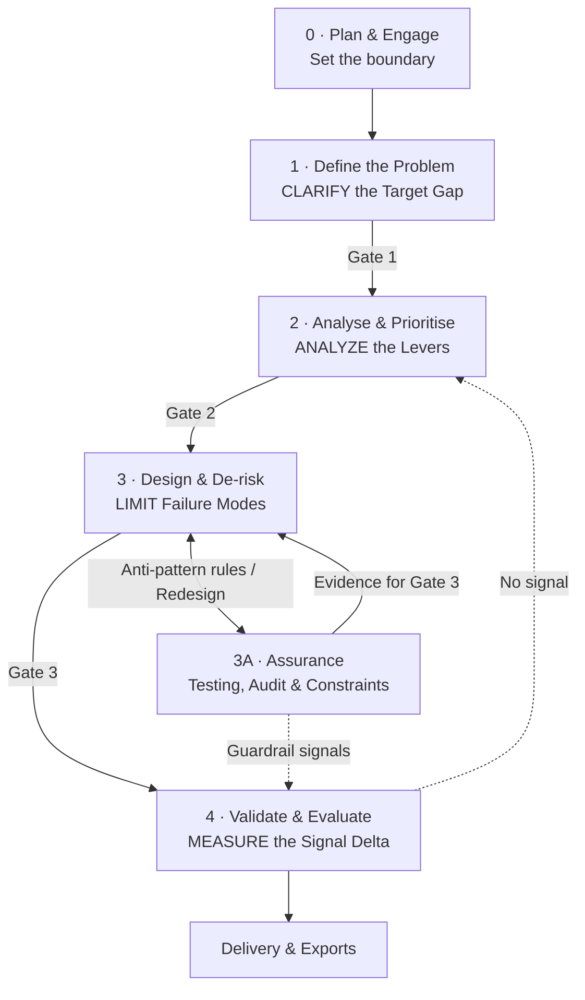

# Business Analysis Workflow (CALM)
> [!NOTE] This file was AI generated based on the [[business analysis workflow.canvas]]

> **Diagram:** [`business analysis workflow (CALM).canvas`](business%20analysis%20workflow.canvas)
> **Thinking framework:** [C.A.L.M.](../CALM/README.md): *"Clarify Gap, Analyze Levers, Limit Failure, Measure Signal"*

This workflow is a complete business analysis lifecycle in which every stage is carried out with C.A.L.M. thinking. The process (stages, deliverables and sign-off gates) follows standard business analysis practice. CALM sets **how the analyst thinks** at each stage.

---

## Overview



| Stage | CALM lens | BABOK knowledge area | Key output | Gate |
| :-- | :-- | :-- | :-- | :-- |
| **0 · Plan & Engage** | Set the boundary first | Planning & Monitoring | BA approach, stakeholder register, system boundary | None |
| **1 · Define the Problem** | Clarify the Target Gap | Strategy Analysis; Elicitation & Collaboration | Problem Statement | Gate 1: sponsor agrees the problem and scope |
| **2 · Analyse & Prioritise** | Analyze the Levers | Requirements Analysis | Prioritised Requirements | Gate 2: stakeholders agree priorities and constraints |
| **3 · Design & De-risk** | Limit Failure Modes | Design Definition; Requirements Life Cycle | Solution Requirements Specification | Gate 3: design sign-off |
| **3A · Assurance** | All four phases, applied to quality, audit and compliance | Design Definition; Solution Evaluation | Assurance Pack | Feeds Gate 3 |
| **4 · Validate & Evaluate** | Measure the Signal Delta | Solution Evaluation | Signal Register, report and close-out | None |

---

## How to Read the Canvas

| Colour | Meaning |
| :-- | :-- |
| **Purple** | **CALM lens.** The thinking rule and BABOK area for the stage, at the top of each group |
| **Uncoloured** | **BA activity.** Work the analyst performs |
| **Orange** | **Failure prompts.** Questions used to find ways the solution could fail |
| **Green** | **Deliverable / output.** An artefact produced by a stage or mini workflow |
| **Red** | **Approval gate.** Stakeholder sign-off before the next stage |
| **Cyan** | **Traceability.** Links that tie every artefact back to the original problem |

- **Solid arrows** show the main flow.
- **Dotted arrows** show loop-backs, conditional paths and traceability links.
- Most stages read **left to right, then right to left** (a snake pattern) within each group.

---

## Stage 0 · Plan & Engage

**CALM lens: set the boundary first.** No gap can be measured until the Entry point, the Exit point and the Baseline Contract are known.

1. **Receive Request.** Log the request exactly as stated. Treat it as a symptom or a proposed solution, not yet as the problem.
2. **Map Stakeholders.** List the sponsor or business owner, primary users (the interface and the API submission point), secondary users (who consume the outputs), administrative users, and tool and data owners.
3. **Define the Baseline Contract.** Record the Entry and Exit points, trigger events, and documented SLAs and target metrics.

**Deliverable:** BA approach, stakeholder register and system boundary.

---

## Stage 1 · Define the Problem

**CALM lens: CLARIFY the Target Gap.** Strip away narratives and proposed solutions until one measurable, root, in-scope gap remains.

1. **Walk the As-Is Process.** With users, trace the process from Entry to Exit. At every hand-off, record what is *expected* against what is *observed*.
2. **Elicit on the 4 Axes.** Use the axes as interview and workshop questions:
   - *Temporal:* how long it takes, and where work waits.
   - *Quantitative:* volumes and drop-offs.
   - *Qualitative:* errors and missing data.
   - *Resource:* cost, effort and rework.
3. **List Candidate Gaps.** Every instance where Expected ≠ Observed becomes a candidate problem.
4. **Root-Cause Triage (Lineage Test).** Trace each gap one level upstream. Keep root gaps and record symptoms as evidence.
5. **Scope Triage (Sphere of Authority).** Gaps the project can control are in scope. A gap that depends on a third party is reframed as an internal gap, or logged as a dependency.
6. **Narrow Scope (Fallback).** If nothing is controllable, shrink the boundary to a component the project owns, and return to the process walk.

**Deliverable: Problem Statement.**

> *Target Gap = Current state − Desired state* (measurable), with the in-scope and out-of-scope items.

**Gate 1:** The sponsor agrees the problem and scope. If not agreed, the work returns to the process walk.

---

## Stage 2 · Analyse & Prioritise

**CALM lens: ANALYZE the Levers.** Every requirement must name the variable it changes and how that variable closes the Target Gap.

1. **Model the System Context** in three categories:
   - **Actors:** users from the stakeholder map, plus primary, secondary and administrative tools.
   - **Inputs:** information required, data sources, volumes, time and budget.
   - **Rules:** business rules, policies, filtering and constraints, access rules and SLAs.
2. **Elicit Candidate Requirements.** For each variable, ask what must change to close the Target Gap.
3. **Stress-test each requirement:**
   - **Elimination Test:** if it is removed, does the process collapse? If yes, it is a **core requirement**, which must be protected.
   - **Amplification Test:** if it is changed, does the outcome move? If yes, it is a **value driver** (a lever).
   - **Control Test:** can the project change it? If not, it goes to the **Constraints Register** as a constraint, assumption or dependency.
4. **Prioritise (Lever Score).** Score each controllable requirement as *Control (1–5) × Impact (1–5)*. The **top 1–3 levers** define the scope of this release. Everything else goes to the **Backlog**, ranked for later releases.

**Deliverable: Prioritised Requirements.** This contains the context model, the top 1–3 levers, the backlog and the constraints register.

**Gate 2:** Stakeholders agree the priorities and constraints.

---

## Stage 3 · Design & De-risk

**CALM lens: LIMIT Failure Modes.** Design by inversion: ask how the chosen levers could break the process, then write the rules that prevent it.

1. **Future-State Options.** Draw up one or more design options per lever, within the constraints register.
2. **Pre-Mortem Workshop (Bounded Inversion).** Ask: *"Using only these levers, within these constraints, how would this solution fail?"* The workshop uses the **failure prompts**, drawn from the original analysis canvas:

| Behavioral              | System & Data         | Operational                 |
| :---------------------- | --------------------- | --------------------------- |
| Out-of-Order Execution  | Scale Extremes        | External Interruptions      |
| Misuse & Invalid Inputs | Null & Partial States | Idempotency & Retries       |
| Race Conditions         | Boundary Values       | Error Visibility & Feedback |
| Permission Boundaries   |                       |                             |

3. **Write Anti-Pattern Rules.** Each failure becomes a business rule, a non-functional requirement or an acceptance criterion. These rules also go to **Section 3A** for classification.
4. **Specify the Solution.** Write user stories or functional requirements with acceptance criteria, per lever.
5. **Change & Transition Plan.** Plan data migration, training, the rollout sequence and the rollback plan.

**Deliverable: Solution Requirements Specification.** This covers functional and non-functional requirements, business rules, acceptance criteria and the transition plan.

**Gate 3: design sign-off.** The business owner and IT sign off, with Compliance and Legal review where applicable. The Section 3A Assurance Pack is presented as evidence.

---

## Section 3A · Assurance: Testing, Audit & Constraints

**CALM lens: every quality, audit and compliance need is a measurable gap with a guardrail signal.** Non-functional requirements are clarified as thresholds, prioritised by risk, tested by inversion and measured *before* sign-off.

This section runs **alongside Stage 3**, so the design is approved with test evidence in hand. It assumes a prototype or test environment is available at that point.

### Inputs

- **Classify Anti-Pattern Rules.** Stage 3's rules are split in two. Functional rules become acceptance criteria in *Specify the Solution*. Non-functional rules go to the NFR Specification.
- **Additional Failure Prompts:** Audit Trail & Record-Keeping, Data Privacy (POPIA), Recovery (RPO/RTO) and Accessibility. RPO is how much data may be lost; RTO is how long recovery may take. These prompts can also be used in the Stage 3 pre-mortem.
- **Constraints Register (maintained here).** It starts from the Stage 2 version and holds:
  - regulatory constraints (FAIS, FICA, POPIA, Companies Act);
  - SLAs from the Baseline Contract;
  - access rules and technical limits.

  Each entry records its source, owner and review date.

### Specifications

- **NFR Specification:** performance and capacity; availability and recovery (RPO/RTO); security and access; data privacy (POPIA); auditability and record-keeping; usability and accessibility; maintainability and supportability.
- **Audit & Record-Keeping:**
  - what is recorded (who, what, when, and before and after values);
  - retention periods, *as confirmed by Compliance*;
  - records that are tamper-evident and retrievable on request;
  - POPIA minimisation, security and disposal.

### Testing mini workflow

1. **Clarify the Threshold.** Restate each requirement as a measurable target, for example *"95% of responses under 3 seconds at peak"*. *"Must be fast"* is not yet defined.
2. **Prioritise (Max-3).** Score risk as *Likelihood × Impact*, focusing on the core components found by the Stage 2 Elimination Test. The top 3 areas receive full testing; the rest receive lighter checks.
3. **Design Scenarios by Inversion.** Ask: *"How would load, outage, misuse or bad data break this design?"* This produces load, stress, failover, security, privacy, audit-trail reconstruction and accessibility scenarios.
4. **Run Tests (R.I.P. + Gradient).**
   - Use a non-production environment with rollback ready, and change one variable per run.
   - Step the load up until output levels off or degrades. That point is the **capacity limit**.
   - QA or IT run the tests; the Business Analyst validates the results.
5. **Read the Results.** Compare each result with its threshold.

### Outcomes

| Result | Next step |
| :-- | :-- |
| **Pass** | **Output: Assurance Pack** (NFR specification, audit requirements, test results and the updated register). It goes to **Gate 3** as evidence, and passed thresholds become **guardrail signals** in the Stage 4 Signal Register. |
| **Fail** | **Redesign:** return to the Stage 3 pre-mortem and future-state options. |
| **New constraint found** | Update the Constraints Register, and return to Stage 2 if the scope changes. |

---

## Stage 4 · Validate & Evaluate

**CALM lens: MEASURE the Signal Delta.** Prove the gap has closed with evidence. Never assume it from delivery alone.

### Define the Success Signal (Signal Discovery)

1. **Anchor to the Target Gap.** The Stage 1 gap measure is the outcome signal. Record its current and desired values.
2. **Trace the Lever Path.** For each top lever, walk from the lever to the first change it causes, then to the Target Gap measure. Find where the effect shows first.
3. **List Candidate Signals on the 4 axes:**
   - *Temporal:* cycle time and wait time.
   - *Quantitative:* volumes, conversion and drop-off.
   - *Qualitative:* error rate and data completeness.
   - *Resource:* cost, effort and rework.
4. **Signal Viability Filter.** Ask of each candidate:
   - Is it measurable from an existing data source?
   - Can it be attributed to one lever?
   - Will it show within a short window?
   - Is the baseline stable enough to show a real change?

   If none pass, return to step 3.
5. **Select (Max-3).** Choose one primary signal per lever, preferring the earliest viable signal. The gap measure stays as the outcome check.
6. **Add Guardrail Signals.** Add up to 3 measures, drawn from the Stage 3 failure modes and constraints, that must not get worse. This includes the guardrails passed from Section 3A.
7. **Specify Each Signal:** name, formula, data source, owner, baseline, target, minimum meaningful change, measurement window and frequency.
8. **Confirm with the Data Owner.** Check the data is available, reliable and reportable. If the data is not available, return to the viability filter.

**Output: Signal Register.** This lists the primary and guardrail signals, with baselines and thresholds.

### Test and roll out

1. **Design UAT / Pilot (R.I.P. Test):**
   - *Reversible:* rollback is planned.
   - *Isolated:* one lever per test.
   - *Proximal:* the signal is visible quickly.
2. **Phased Rollout (Gradient).** Move from a pilot group to a wider group, then to full rollout, comparing the signal at each step.
3. **Read the Signal.** Compare the result with the Target Gap baseline:

| Reading                  | Action                                                                                    |
| :----------------------- | ----------------------------------------------------------------------------------------- |
| **Still Impoving**       | Continue to the next rollout step.                                                        |
| **Plateau Reached**      | Lock the setting and baseline the new process.                                            |
| **Degraded / No signal** | Adjust the lever, or return to **Stage 2**, or to **Stage 1** if the gap itself was wrong |

### Reporting and close-out

- **Questions Answered:** is the Target Gap closed? (current state against desired state)
- **Metrics, Data Points, Decisions:** the signal per lever, the plateau setting and the decisions taken.
- **Delivery & Exports (close-out):** final report, handover to operations and lessons learnt.

---

## Traceability Thread

The cyan lane on the right of the canvas runs through every stage. It ensures every artefact can be traced back to the original problem.

| Link | What is traced | Purpose |
| :-- | :-- | :-- |
| **T0** | Request ID | Records the original request and stakeholders |
| **T1** | Target Gap ID | Records the baseline measure of the current state |
| **T2** | Requirement → Lever → Target Gap | Every requirement names its lever |
| **T3** | Acceptance criterion → Anti-pattern rule → Requirement | Every test traces to a failure it prevents |
| **T3A** | NFR → Constraint / Failure prompt → Test result → Guardrail signal | Every quality claim has test evidence |
| **T4** | Signal → Lever → Target Gap | Each signal names the lever it measures and the gap it proves closed |

---

## Loop-backs

| From | Condition | Returns to |
| :-- | :-- | :-- |
| Scope Triage (Stage 1) | No gap is within the project's control | Narrow Scope, then the As-Is process walk |
| Gate 1 | Sponsor does not agree the problem or scope | As-Is process walk |
| Signal Viability Filter (Stage 4) | No candidate signal passes | List Candidate Signals |
| Confirm with Data Owner (Stage 4) | Data is not available | Signal Viability Filter |
| Phased Rollout (Stage 4) | Signal still improving | Next rollout step |
| Read the Signal (Stage 4) | Degraded or no signal | Stage 2 (or Stage 1 if the gap was wrong) |
| Section 3A results | Test failed | Stage 3 pre-mortem (redesign) |
| Section 3A results | New constraint found | Constraints Register (and Stage 2 if scope changes) |

---

## Quick Reference

```
================================================================================
                 BUSINESS ANALYSIS WORKFLOW · C.A.L.M. SUMMARY
================================================================================
0. PLAN & ENGAGE ........ Request → Stakeholders → Baseline Contract
1. DEFINE (CLARIFY) ..... As-Is walk → 4 Axes → Candidate Gaps
                          → Lineage Test → Sphere of Authority
                          → PROBLEM STATEMENT → GATE 1
2. ANALYSE (ANALYZE) .... Actors / Inputs / Rules → Candidate Requirements
                          → Elimination / Amplification / Control
                          → Lever Score (Top 1-3) → GATE 2
3. DESIGN (LIMIT) ....... Options → Pre-Mortem (Failure Prompts)
                          → Anti-Pattern Rules → Specification → GATE 3
3A. ASSURANCE ........... Classify Rules → NFR + Audit Specs → Threshold
                          → Max-3 → Inversion Scenarios → R.I.P. Tests
                          → ASSURANCE PACK (to Gate 3 + Guardrails)
4. VALIDATE (MEASURE) ... Signal Discovery → SIGNAL REGISTER
                          → R.I.P. Pilot → Gradient Rollout → Read Signal
                          → Reporting → Delivery & Exports
================================================================================
```
