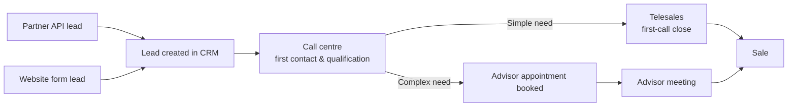

> [!NOTE]
> This file was AI generated as a fictional worked example. All names, figures and events are illustrative.

# Stage 0 · Plan & Engage

**Project:** Lead-to-Sale Conversion Decline
**CALM principle:** Set the boundary first.
**Status:** Complete
**Date:** 6 November 2026

---

## 1. Request Log

| Field | Entry |
| :-- | :-- |
| **Request ID (T0)** | REQ-2026-014 |
| Date received | 6 November 2026 |
| Requester / Sponsor | Head of Distribution |
| **Request as stated** | *"We are experiencing a decrease in lead-to-sale conversion. It has dropped from 15% to 8% over the last 10 months. Analyse the data and come up with a plan to solve the issue."* |
| Request type | **Symptom.** The request describes an outcome (lower conversion), not a cause. No solution has been proposed. |
| Product in scope | Wills & estate planning |

> **BA note:** The 7-percentage-point drop is the symptom the sponsor sees. The root problem is not yet known and must not be assumed. Possible causes include lead quality, contact speed, qualification, telesales or advisor performance. Stage 1 will isolate it.

---

## 2. Stakeholder Register

| Group | Stakeholder | Role in the process | Interest / influence |
| :-- | :-- | :-- | :-- |
| **Sponsor** | Head of Distribution | Owns the lead channels and the conversion target; approves Gates 1 and 3 | High / High |
| **Primary users** (lead entry) | Partner Integration Owner | Manages leads submitted by the partner through the **API submission point** | High / Medium |
| | Digital Marketing Lead | Owns the website lead forms and online campaigns | High / Medium |
| | Call Centre Agents | Make first contact and qualify every lead | High / Low |
| **Secondary users** (use the output of qualification) | Telesales Agents | Close simple-need leads on the first call | High / Low |
| | Financial Advisors | Receive complex-need leads as booked appointments and close the sale | High / Medium |
| | Sales Managers | Use conversion reports to manage teams | Medium / Medium |
| **Administrative users** | Call Centre Team Leaders | Manage agent queues, schedules and lead allocation | Medium / Medium |
| | CRM Administrator | Configures lead routing, statuses and user access | Medium / Medium |
| **Tool & data owners** | IT (CRM owner) | Owns the CRM, where all lead and sale records live | Medium / High |
| | BI / Reporting | Owns the conversion reports and dashboards | Medium / Medium |
| **Assurance** | Compliance | Advises on POPIA (lead consent and use of personal information) and sales conduct | Medium / High |

---

## 3. Baseline Contract

### System boundary

| Boundary | Definition |
| :-- | :-- |
| **Entry** | A lead record is created in the CRM, either from the partner API or from a website form |
| **Exit** | A **sale**: a will / estate-planning instruction signed and accepted *(definition to be confirmed in Stage 1)* |

### Process flow

### Trigger events

1. Lead received in the CRM (from the partner API or a web form)
2. First contact attempt by the call centre
3. Qualification outcome: simple need or complex need
4. Telesales close attempt (simple need) **or** advisor appointment booked (complex need)
5. Advisor meeting held
6. Sale recorded

### Documented SLAs and targets

| Measure | Documented target | Source |
| :-- | :-- | :-- |
| Speed to first contact | **Within 1 hour** of lead creation | Call centre SLA |
| Lead-to-sale conversion | **15%** | Distribution targets |
| Qualification → appointment time | *Not documented* | — |
| Appointment → meeting held | *Not documented* | — |
| Telesales first-call close rate | *Not documented* | — |

> **BA note:** Only the first and last steps of the process have documented targets. The steps in between have none, so there is nothing to measure them against. This will be tested during the Stage 1 process walk.

---

## 4. BA Approach

| Item | Approach |
| :-- | :-- |
| **Elicitation methods** | CRM funnel data analysis; process walk with call centre, telesales and advisors; interviews with the Partner Integration Owner and Digital Marketing Lead |
| **Analysis period** | January 2026 (15% baseline) to October 2026 (8%) |
| **Governance** | Weekly 30-minute check-in with the Head of Distribution; Gates 1–3 as per the BA Process Guide |
| **Requirements storage** | Project folder, with the traceability matrix maintained from Stage 1 onward |
| **Data handling** | Analysis uses aggregated CRM extracts only. Personal information is not copied outside the CRM, in line with POPIA. |
| **Indicative timeline** | Stage 1: 2 weeks · Stage 2: 2 weeks · Stage 3 / 3A: 3 weeks · Stage 4: pilot of 4–6 weeks |

---

## 5. Open Questions for Stage 1

1. Has the **lead mix** between the partner API and the website changed over the 10 months?
2. Is the **1-hour contact SLA** still being met?
3. **Where in the funnel** does the drop occur: contact, qualification, telesales close, appointment or advisor close?
4. What **changes** happened during the period (systems, staffing, campaigns, partner)?
5. What exactly counts as a **sale** in the CRM, and has that definition changed?

---

## Checklist

- [x] Request logged with Request ID
- [x] Stakeholder register completed
- [x] Entry, Exit and trigger events documented
- [x] SLAs and target metrics collected
- [x] BA approach agreed with the sponsor

**Output:** BA approach, stakeholder register and system boundary. **Next:** [Stage 1 · Define the Problem](./01%20-%20Define%20the%20Problem.md)
