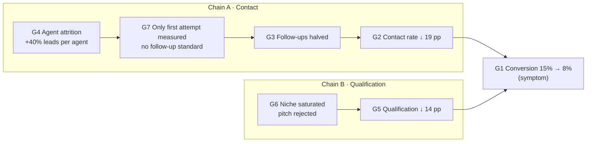

> [!NOTE]
> This file was AI generated as a fictional worked example. All names, figures and events are illustrative.

# Stage 1 · Define the Problem

**Project:** Lead-to-Sale Conversion Decline (REQ-2026-014)
**CALM principle:** CLARIFY the Target Gap. Strip away narratives and proposed solutions until one measurable, root, in-scope gap remains.
**Status:** Complete. Gate 1 approved.
**Date:** 20 November 2026

---

## 1. As-Is Process Walk

The BA walked the process from Entry (lead created in the CRM) to Exit (signed and paid instruction). The walk combined CRM funnel extracts with sessions alongside call centre agents, telesales agents and advisors. The table compares **January 2026** (the 15% baseline month) with **October 2026** (8%).

| Step | Expected (January 2026) | Observed (October 2026) | Variance |
| :-- | --: | --: | :-- |
| Leads received per month | 2 000 | 2 000 | Stable |
| Lead mix (Partner API / Website) | 55% / 45% | 55% / 45% | Stable |
| First attempt within 1 hour (SLA) | 90% | 88% | Stable (SLA mostly met) |
| Contact attempts per lead (5-day window) | 4.1 | 1.9 | **↓ 54%** |
| **Leads reached** | 1 400 (70%) | 1 020 (51%) | **↓ 19 pp** |
| Reached leads: "Not interested" | 448 (32%) | 490 (48%) | **↑ 16 pp** |
| Reached leads: other disqualification | 252 (18%) | 163 (16%) | Stable |
| **Leads qualified** (% of reached) | 700 (50%) | 367 (36%) | **↓ 14 pp** |
| Simple need → telesales close rate | 420 → 126 (30%) | 220 → 66 (30%) | Rate stable |
| Complex need → appointment held | 280 → 224 (80%) | 147 → 118 (80%) | Rate stable |
| Appointment held → advisor sale | 224 → 174 (78%) | 118 → 92 (78%) | Rate stable |
| **Sales (signed and paid)** | **300 (15.0%)** | **158 (7.9%)** | **↓ 7.1 pp** |

> **Finding:** Every step **after** qualification converts at the same rate as in January. The whole decline happens at two points: **leads reached** and **leads qualified**. Both lead channels show the same decline.

---

## 2. Elicitation on the 4 Axes

| Axis | Observation | Source |
| :-- | :-- | :-- |
| **Temporal** | The first attempt still meets the 1-hour SLA (88%). Follow-up attempts on days 2–5 have mostly disappeared. | CRM activity log |
| **Quantitative** | Contact rate fell from 70% to 51%, and qualification rate from 50% to 36%. Lead volume and channel mix are unchanged. | CRM funnel extract |
| **Qualitative** | A QA sample of "Not interested" calls showed that clients hear the initial pitch and then say they are not interested. The sale definition (signed and paid) has not changed. | Call recordings; CRM configuration |
| **Resource** | The call centre lost about 30% of its experienced agents, so leads per agent per day rose by about 40%. Team leaders report that agents put new leads first to meet the 1-hour SLA, so follow-ups are left until too late. | Change history (Call Centre, IT, Digital); team leader interviews |

> **BA note:** The BA did not have direct access to the change history. It was requested from and supplied by Call Centre management, IT and Digital Marketing.
>
> Call Centre management also reported that *"the call centre has been open for a while and is struggling to find clients in its current niche"*.

---

## 3. Candidate Gaps (Expected ≠ Observed)

| ID | Candidate gap | Axis |
| :-- | :-- | :-- |
| G1 | Lead-to-sale conversion fell from 15% to 8% | Quantitative |
| G2 | Contact rate fell from 70% to 51% | Quantitative |
| G3 | Follow-up attempts per lead fell from 4.1 to 1.9 | Temporal / Resource |
| G4 | Leads per agent rose by about 40% after the loss of experienced agents | Resource |
| G5 | Qualification rate fell from 50% to 36% ("Not interested" up from 32% to 48%) | Quantitative / Qualitative |
| G6 | Leads in the current niche reject the initial pitch (the niche is saturated) | Qualitative |
| G7 | The only contact SLA measures the **first** attempt. There is no follow-up standard and no capacity-based prioritisation. | Structural |

---

## 4. Root-Cause Triage (Lineage Test)

Each gap was traced one level upstream. Two independent chains emerged:

| Gap | Lineage result |
| :-- | :-- |
| G1 | **Symptom.** Fully explained by G2 and G5, because downstream rates are unchanged. |
| G2 | **Symptom** of G3 |
| G3 | **Symptom** of G4 and G7. Under load, agents meet the only measured SLA and drop the unmeasured follow-ups. |
| G4 | **Root (Chain A)**, but see the Sphere of Authority Test below |
| G7 | **Root (Chain A).** It is the structural reason that extra load affects follow-ups rather than first contact. |
| G5 | **Symptom** of G6 |
| G6 | **Root (Chain B)** |

### Contribution of each chain

Modelled on October volumes, with all downstream rates held constant:

| Scenario | Conversion |
| :-- | --: |
| Current (October 2026) | 7.9% |
| Restore **contact rate only** (Chain A) to 70% | **≈ 10.9%** |
| Restore **qualification rate only** (Chain B) to 50% | ≈ 11.0% |
| Restore both | 15.0% |

> Each chain accounts for about **3 percentage points** on its own. The remaining point comes from the two chains acting together.

---

## 5. Scope Triage (Sphere of Authority Test)

The Head of Distribution can change **call-handling process and priorities**, but **not headcount**. Hiring sits with Operations and HR.

| Gap | Within the sponsor's control? | Treatment |
| :-- | :-- | :-- |
| G4 Agent capacity (headcount) | **No.** It sits with Operations / HR. | Logged as a **dependency**. It is reframed as an internal structural gap through G7. |
| G7 Follow-up standard and prioritisation | **Yes.** Call-handling rules, CRM task routing and SLA definitions are within Distribution's authority. | **In scope** |
| G6 Niche saturation and initial pitch | Partly. Targeting and pitch sit with Distribution; the market itself does not. | **Deferred** by the sponsor to a separate request (see Backlog) |

> **Reframe:** *"The call centre does not have enough agents"* (outside the sponsor's control) becomes *"Lead handling has no follow-up cadence standard and no capacity-based prioritisation, so follow-ups are dropped when load increases"* (within the sponsor's control).

---

## 6. Problem Statement

| Field | Entry |
| :-- | :-- |
| **Target Gap ID (T1)** | GAP-014-A |
| Gap description | Leads are not reached because follow-up attempts are dropped when call centre load increases. There is no follow-up cadence standard and no capacity-based prioritisation. |
| Current verifiable state | Contact rate **51%** (October 2026); 1.9 attempts per lead |
| Desired target state | Contact rate **70%** (January 2026 baseline); at least 4 attempts per lead within 5 days |
| **Target Gap (Current − Desired)** | **−19 percentage points** of contact rate |
| Expected effect on conversion | 7.9% → about **10.9%** |
| Evidence | Lineage chain G4 → G7 → G3 → G2; funnel extract; team leader interviews; change history |
| **In scope** | Follow-up cadence rules; lead prioritisation and queue rules; CRM call-task routing; contact SLA definitions and reporting |
| **Out of scope** | Hiring and headcount; niche targeting and initial pitch (REQ-2026-015); lead capture (partner API and website); telesales and advisor stages (rates stable) |
| **Dependencies** | Operations / HR (agent capacity); IT (CRM configuration changes) |

### Business objective and expectation risk

The Head of Distribution has set an overall objective of **15% conversion within 6 months (by May 2027)** and **20% within 12 months (by November 2027)**.

> [!WARNING]
> **BA risk note (raised at Gate 1):** Closing GAP-014-A alone is expected to lift conversion to about **11%**. Reaching 15% also requires Chain B (niche and pitch) to be resolved. **20% is above the historic baseline**, and the analysis so far does not support it. The overall objective is recorded as a business objective, not as this project's Target Gap. Progress towards it will be reported separately.

### Backlog

| ID | Item | Status |
| :-- | :-- | :-- |
| REQ-2026-015 | Chain B: niche saturation and initial pitch rejection (qualification 50% → 36%) | Logged as a separate request for its own CALM cycle |

---

## Checklist

- [x] As-is process walked from Entry to Exit with users
- [x] All 4 axes covered
- [x] Candidate gaps listed
- [x] Root gap isolated (Lineage Test)
- [x] Scope set (Sphere of Authority Test)
- [x] Problem Statement completed and measurable

## Gate 1 · Problem & Scope Approval

| Item | Outcome |
| :-- | :-- |
| Approver | Head of Distribution |
| Decision | **Approved.** GAP-014-A is the Target Gap for this project. |
| Conditions | The expectation risk is acknowledged. REQ-2026-015 is logged for Chain B. The Operations / HR capacity dependency is recorded. |
| Date | 20 November 2026 |

**Next:** [Stage 2 · Analyse & Prioritise](./02%20-%20Analyse%20%26%20Prioritise.md)
