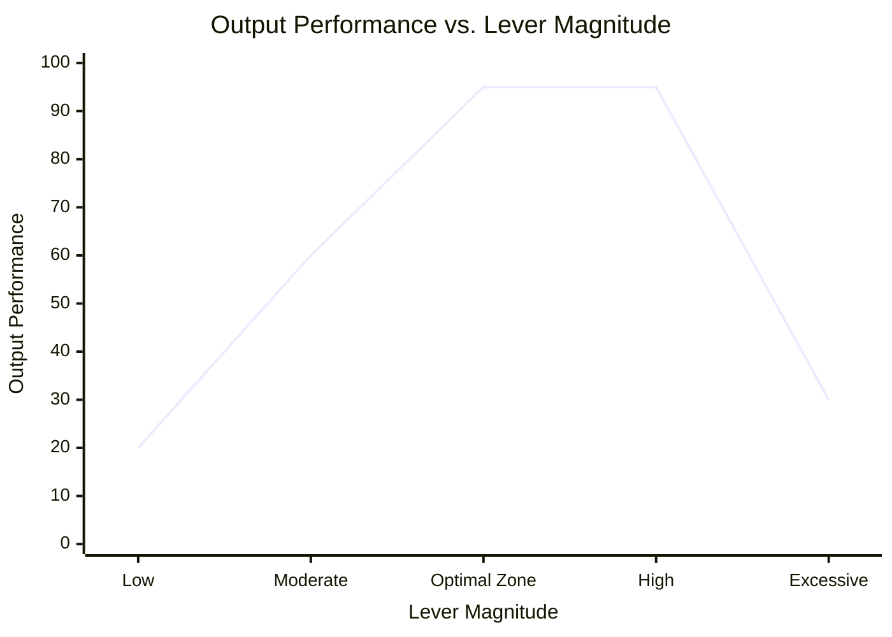
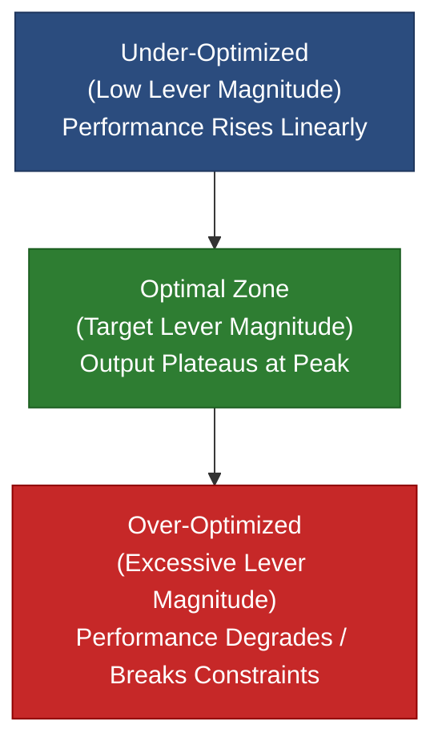

# The C.A.L.M. Framework
> **Mnemonic Saying:** *"Clarify Gap, Analyze Levers, Limit Failure, Measure Signal"*
>
> A universal mental model and system deconstruction framework designed to isolate root causes, eliminate noise, and establish clear, verifiable execution paths under high pressure.

---

## Overview

When faced with complex, chaotic, or unfamiliar problems, **C.A.L.M.** provides an unforgettable 4-phase sequence for systematic resolution:

1. **C**larify the Target Gap *(Isolating Objective Reality)*
2. **A**nalyze System Levers *(System Deconstruction & Bloat Control)*
3. **L**imit Failure Modes *(Bounded Inversion & Strategy Bridge)*
4. **M**easure Signal Delta *(Hypothesis Loop & Plateau Benchmarking)*

---

## Phase 1: CLARIFY the Target Gap (Isolating Objective Reality)

**Goal:** Strip away narratives, assumptions, and emotional noise to define the precise, factual problem state.

### 1. Zero-Knowledge Discovery Protocol (For Unfamiliar Domains)
When analyzing a domain without prior expertise, treat the system as a black box and locate gaps purely by measuring variances against a baseline:

1. Establish **Baseline** Contract: Identify documented SLAs, target metrics, system boundaries (Entry/Exit), and trigger events.
2. **Execute Pipeline Walk:** Trace workflow step-by-step from Entry to Exit. Log expected state vs. observed state at every transition node.
3. **Audit** Across the 4 Universal Axes:
	* **Temporal:** Latency, duration, execution delays, sequence out-of-order.
	* **Quantitative:** Rate drops, volume losses, throughput bottlenecks.
	* **Qualitative:** Corrupted state, missing payload fields, error states.
	* **Resource:** Over-consumption of memory, money, labor, or compute.
4. **Compile Candidate Gaps:** Every instance where $\text{Expected} \neq \text{Observed}$ becomes a Candidate Gap.

### 2. Calculate the Target Gap
Define the problem strictly as a verifiable delta between two objective states:

$$\text{Target Gap} = \text{Current Verifiable State/Metric} - \text{Desired Target State/Metric}$$

*If a gap cannot be stated as a binary, structural, or numerical value, it is not yet defined accurately.*

### 3. The Gap Triage Filter (Proving Strategy)
Run every candidate gap through these two sequential gates to select the primary target gap:

1. **The Lineage Test:** Is this gap a root mismatch or merely a downstream symptom of another gap?
	* Rule: Trace the gap upstream one level. If Gap B exists only because Gap A exists, discard Gap B and isolate Gap A.
2. **The Sphere of Authority Test:** Do you have direct authority to modify this gap, or can you influence it via a 1-degree proxy?
	* *Rule:* If closing the gap requires third-party action outside your control, redefine the gap as an internal structural state (e.g., instead of *"Vendor API is slow"*, define the gap as *"System lacks an asynchronous fallback mechanism"*).

> **Fallback Rule:** If all candidate gaps fail the Sphere of Authority Test, shrink your system boundary until you reach a component within your direct control.

>**Phase 1 Output:** A single, provable, non-symptomatic gap definition stripped of all assumptions.

---

## Phase 2: ANALYZE System Levers (System Deconstruction)

**Goal:** Map the internal system architecture, separate load-bearing nodes from actionable levers, and prune non-essential variables.

### 1. Variable Taxonomy & Boundary Classification
Every problem operates within a system composed of three variable types:

| Variable Type | Definition                                           | System Examples                                                             |
| :------------ | :--------------------------------------------------- | :-------------------------------------------------------------------------- |
| **Inputs**    | What flows into or through the system.               | Network payloads, raw data, incoming traffic, execution args, budget, time. |
| **Rules**     | Logic, limits, and configurations processing inputs. | Rate limits, timeouts, business logic, algorithms, access rules.            |
| **Actors**    | Entities executing the rules on the inputs.          | Web servers, database workers, developers, background processors, APIs.     |

> **Cross-Category Conflict Rule:** If a variable appears to cross categories (e.g., an Input causing a Rule constraint), split it by **Intervention Point**. If you cannot modify the Input directly, shift intervention to the Rule or Actor.

### 2. The Variable Stress Test
Run every identified component through the stress test sequentially:

1. **Elimination Test:** *"If I completely removed [Variable X], would the system collapse?"*
	* *If Yes:* It is a **Load-Bearing Node**.
2. **Amplification Test:** *"If I scaled or altered the volume, velocity, or friction of [Variable X], would system output change?"*
	* *If Yes:* It is an **Active Lever**.
3. **Control Test:** *"Do I have physical or structural authority to change this variable?"*
	* *If No:* Move it immediately to the **Boundary Conditions Box**.

*Note: Nodes can be dual-property (e.g., a database engine is a Load-Bearing Actor, while its connection pool size is an Active Rule).*

### 3. Bloat Pruning (The Max-3 Rule)
To prevent operational bloat, evaluate every variable that passed the Control Test:

$$\text{Lever Score} = \text{Control Rating } (1\text{--}5) \times \text{Impact Rating } (1\text{--}5)$$

Sort all scored variables and select **ONLY the top 1 to 3 levers**. Move all other variables to the backlog.

>**Phase 2 Output:** 1 to 3 isolated, high-impact levers, accompanied by an explicit list of **Boundary Conditions** (environmental constraints).

---

## Phase 3: LIMIT Failure Modes (Bounded Inversion & Strategy)

**Goal:** Use the prioritized levers to map failure modes, invert them into strategic rules, and build a concrete execution plan.

### 1. Bounded Inversion
Prevent absurd or unhelpful scenarios by bounding inversion strictly to the levers and boundary conditions established in Phase 2.

* **Bounded Prompt:** *"Using ONLY my 1 to 3 selected levers inside my defined Boundary Conditions, how do I configure these variables to guarantee maximum system failure?"*
* **The Action:** Write down the explicit sequence of steps required to ensure total failure.

### 2. The Execution Bridge Matrix
Map the inverted steps directly into actionable anti-pattern rules and execution steps:

$$\text{[Phase 2 Lever]} \longrightarrow \text{[Inverted Sabotage Step]} \longrightarrow \text{[Anti-Pattern Rule]} \longrightarrow \text{[Execution Action Plan]}$$

#### Execution Bridge Template
* **Lever 1: [Name of Lever]**
  * *Inverted Sabotage:* How to use this lever to break the system.
  * *Anti-Pattern Rule:* The exact operational boundary required to prevent this failure.
  * *Execution Action Plan:* The structural change or feature build required.

**Phase 3 Output:** A lean, execution-ready action plan designed to structurally negate failure modes.

---

## Phase 4: MEASURE Signal Delta (Hypothesis & Feedback Loop)

**Goal:** Validate levers through isolated testing and establish an optimality benchmark.

### 1. The R.I.P. Test for Test Viability
Before executing a test, verify that it meets all three viability criteria:

* **Reversible:** Can the intervention be rolled back in under 5 minutes if catastrophic failure occurs?
* **Isolated:** Does the experiment manipulate *exactly one* lever while holding all other system variables constant?
* **Proximal Signal:** Does the test yield a measurable telemetry delta within a short, predictable feedback window?

### 2. Gradient Execution & Optimality Benchmarking
To avoid binary (On/Off) assumptions, test interventions across a variable gradient (e.g., test thresholds at incremental stages). Plot output performance against lever magnitude:





* **Under-Optimized:** Output scales linearly with lever increases. Continue scaling.
* **Optimal (Plateau Benchmark):** Output plateaus while system efficiency and stability remain optimal. **Lock this setting.**
* **Over-Optimized / Degraded:** Increasing lever magnitude triggers secondary bottlenecks or breaks Boundary Conditions. Reduce magnitude.

**Phase 4 Output:** Empirical proof of root cause resolution, or actionable telemetry signaling an immediate return to Phase 2 for system re-deconstruction.

---

## Quick Reference Summary

```
================================================================================
                         C.A.L.M. EXECUTION SUMMARY
================================================================================
Mnemonic: "Clarify Gap, Analyze Levers, Limit Failure, Measure Signal"

1. CLARIFY GAP: Zero-Knowledge Audit (Temporal, Quantitative, Qualitative, Resource)
   ├── Calculate: Target Gap = Current State - Desired State
   └── Filter: Lineage Test (Root vs Symptom) & Sphere of Authority Test.

2. ANALYZE LEVERS: Classify System Variables (Input / Rule / Actor)
   ├── Stress Test: Elimination (Load-Bearing), Amplification (Active), Control (Authority).
   ├── Non-controllable items ---> Boundary Conditions Box.
   └── Score: (Control 1-5) x (Impact 1-5) ---> Select TOP 1-3 Levers.

3. LIMIT FAILURE: Bounded Inversion on Top 1-3 Levers inside Boundary Conditions.
   └── Map: Inverted Sabotage ---> Anti-Pattern Rule ---> Execution Action Plan.

4. MEASURE SIGNAL: Validate via R.I.P. Test (Reversible, Isolated, Proximal Signal).
   └── Apply Gradient Execution ---> Locate Plateau Benchmark (Optimal State).
================================================================================
```