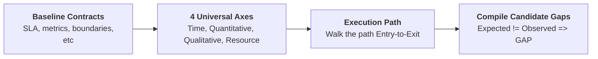

# C.A.L.M. Applications

Here are examples of my C.A.L.M. problem solving framework.

## What does it stand for?

- **C**larify the target gaps
- **A**nalyze the system *Levers*
- **L**imit failure modes
- **M**easure signal data

## Okay? What does the above actually mean?

[Framework Mockup](https://github.com/bouwerja/learning/blob/main/research/CALM/README.md)

### 1. CLARIFY the target gaps

This has 3 parts to it:
1. Zero-Knowledge Discovery (ZKD).
2. Calculate Target Gap.
3. Gap Triage Filter.

**1.1 ZKD**

This is a method to discover gaps without prior domain knowledge.

*Basic process*

>*I do also use the 5 Whys method*

**1.2 Calculate Target Gap**

$$\text{Target Gap} = \text{Current Verifiable State/Metric} - \text{Desired Target State/Metric}$$

>*If a gap cannot be stated as a binary, structural, or numerical value, it is not yet defined accurately.*

**1.3 Gap Triage Filter**

1. **Lineage Test**: Is *Gap A* caused by *Gap B*?
    - *Rule:* Discard *Gap B* because if *Gap A* is solved so will *Gap B*.
2. **Sphere of Authority**: Can you control the *Gap*?
    - *Rule:* No direct control then *Gap* becomes a constraint.

> **Fallback Rule:** If all candidate gaps fail the Sphere of Authority Test, shrink your system boundary until you reach a component within your direct control.

>**Phase 1 Output:** A single, provable, non-symptomatic gap definition stripped of all assumptions.
